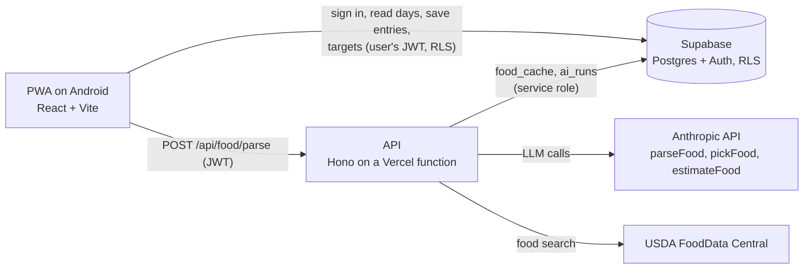

# Disciplined Sidekick

## Summary

Disciplined Sidekick is a phone-first web app (an installable PWA) for tracking what I eat against daily targets. It has one user: me. You type a meal in plain words, such as "2 eggs and 150 g blueberries". The app splits it into foods, looks each one up in the USDA FoodData Central database, and shows calories, protein and grams of fruit and vegetables against my targets. I built it because logging apps make me search and weigh every item. I also wanted a real project for practising AI-assisted engineering with Claude Code, with tests, CI and review gates around the AI.

## What it does

| Part                   | Status       | What exists today                                                                                                                                                                                                                                                                                                          |
| ---------------------- | ------------ | -------------------------------------------------------------------------------------------------------------------------------------------------------------------------------------------------------------------------------------------------------------------------------------------------------------------------- |
| Summary / health score | Partly built | The Today screen shows three bars for the viewed day: calories, protein, and fruit/veg grams (toward an 800 g goal), each against a target set in Settings ([`today.tsx`](apps/web/src/today/today.tsx), [`pillars.ts`](packages/core/src/pillars.ts)). There is no health score yet. **Planned:** a daily status summary. |
| Food intake            | Built        | Free-text logging, a preview where you can edit grams before saving, delete, re-log a past item, and browse past days ([`food-log.tsx`](apps/web/src/food/food-log.tsx), [`log-food.ts`](server/food/log-food.ts)).                                                                                                        |
| Health metric intake   | **Planned**  | Not built. The plan is to import body weight from a scale and recovery data from Whoop.                                                                                                                                                                                                                                    |
| Fitness planning       | **Planned**  | Not built. The plan is to import training program PDFs, log workouts, and later have AI rewrite the training and nutrition plan.                                                                                                                                                                                           |

## Where the AI is

All LLM calls go through one runner, [`runAiFunction`](server/ai/run.ts), using the Anthropic SDK. Food logging is a **fixed pipeline**: code decides every step, and each LLM call is a single request with a typed answer. Nothing here is an agent.

When you log food, `POST /api/food/parse` runs [`logFood`](server/food/log-food.ts):

| Step                   | LLM call                                               | Input                                            | Output                                                                                                                                | Model ([`config.ts`](server/ai/config.ts)) |
| ---------------------- | ------------------------------------------------------ | ------------------------------------------------ | ------------------------------------------------------------------------------------------------------------------------------------- | ------------------------------------------ |
| 1. Split the text      | [`parseFood`](server/ai/functions/parse-food.ts)       | The typed text                                   | A list of foods: name, generic name, USDA search words, grams, brand, whether it counts as fruit/veg, whether the portion was guessed | Claude Sonnet 5.5, medium effort           |
| 2. Search USDA         | none (code)                                            | The search words                                 | Up to 5 USDA results; for a branded food, code first keeps only results from that brand                                               | –                                          |
| 3. Pick a match        | [`pickFood`](server/ai/functions/pick-food.ts)         | The food and the USDA results                    | One USDA id, or none                                                                                                                  | Claude Haiku 5.5, low effort               |
| 4. Estimate (fallback) | [`estimateFood`](server/ai/functions/estimate-food.ts) | The food name, plus brand or restaurant if named | kcal and protein per 100 g                                                                                                            | Claude Haiku 5.5, low effort               |

Step 4 runs only when USDA has no usable match, or for restaurant food (which skips USDA). Calories and protein are then computed in code from grams × per-100 g values ([`nutrition.ts`](packages/core/src/nutrition.ts)). A fifth function, [`demo`](server/ai/functions/demo.ts), classifies a meal as breakfast/lunch/dinner/snack. It exists to test the call layer and is not used by the UI.

Guards:
- **Structured output.** Each function has a zod schema, sent as the output format. The answer is checked against it. Bad JSON or a schema failure is an error, not a guess ([`run.ts`](server/ai/run.ts)).
- **Refusal and truncation** are detected from the stop reason and raised as their own errors.
- **Retries and timeouts.** Up to 2 retries on rate limits, 5xx and connection errors, with backoff. Each attempt times out after 45 s ([`timeouts.ts`](server/ai/timeouts.ts)).
- **Code checks on the model's answers.** A pick that was not one of the candidates fails the entry. The brand filter is code, not the model ([`brand.ts`](server/food/brand.ts)). A USDA match with no energy or protein value falls back to an estimate.
- **No silent failure.** Any error fails the whole entry. The user sees a retry message and keeps the text. Nothing is cached for a failed lookup.
- **Caching.** Every successful pick or estimate is stored in `food_cache` by food name (and brand), so the same food is not looked up twice ([`cache.ts`](server/food/cache.ts)).
- **Human check.** Nothing is saved until you press Done. Estimated items and guessed portions are labelled, and grams can be edited first.
- **No identity in prompts.** Prompts are built from the input only. Tests check the user's id, email and name never reach the API ([`parse-food.test.ts`](server/ai/functions/parse-food.test.ts)).
- **Logging.** Every call writes one `ai_runs` row: status, attempts, tokens, cost, input, output, validation errors, prompt and schema versions. Rows are deleted after 90 days.

## Architecture



- The browser talks to Supabase directly for reads, saves and deletes, using the signed-in user's token. Row level security is the guard.
- Only food parsing goes through the API, because it needs the server-side Anthropic and USDA keys. The API checks the user's token against Supabase's public keys.
- Every `public` table has RLS on, with policies that let a user reach only their own rows. `anon` has no access.

Full detail: [ARCHITECTURE.md](ARCHITECTURE.md). Platform decisions: [docs/adr/](docs/adr).

## Evals

**In progress.** An eval harness will run a set of real entries with known answers through the food pipeline and score each step: item split, grams, USDA pick, estimates and entry totals. Tracked in Linear as HEA-17 (private workspace).

<!-- TODO(owner): fill in the eval approach, golden-set size and current results once HEA-17 lands. -->

## How it was built

Built with [Claude Code](https://claude.com/claude-code). I write and refine the tickets, test each change by hand, and merge. Claude Code writes the code and the tests.
- **Agent instructions.** [`AGENTS.md`](AGENTS.md) (imported by [`CLAUDE.md`](CLAUDE.md)) sets the rules: test-first, pinned dependencies, secrets server-only, migrations with explicit grants, and which checks to run for which changed paths.
- **Test-first.** Each ticket lands as a "failing tests" commit, then the implementation, then review fixes. You can see this in `git log`.
- **Pre-commit hook.** [lefthook](lefthook.yml) runs Biome on staged files.
- **CI.** [GitHub Actions](.github/workflows/ci.yml) runs lint, typecheck, tests, build, and `verify:build`, which fails if a server secret ends up in the client bundle. A second job applies every migration to an empty Postgres and checks RLS and access rules for each table ([`scripts/check-*.sh`](scripts)).
- **Repo convention tests.** [`tests/`](tests) checks config, CI and docs conventions.
- **Review.** Each PR gets a multi-angle AI review (`/pr-review` from the [software-factory](https://github.com/VTHoop/software-factory) plugin, pinned in [`.claude/settings.json`](.claude/settings.json)). Findings are fixed test-first or answered. Many PRs were opened by that plugin's unattended script, which takes a ready ticket to a reviewed PR.
- **Project skills.** [`.claude/skills/`](.claude/skills): `manual-test` (drive a PR's changes in a browser against local Supabase) and `next-up` (review project state and suggest what to do next).

## Setup

Prerequisites: Node 24, pnpm 11 (via `corepack enable`), and Docker plus the [Supabase CLI](https://supabase.com/docs/guides/local-development/cli/getting-started) for the database.

Environment variables are listed in [`.env.example`](.env.example). Server values (`SUPABASE_URL`, `SUPABASE_SERVICE_ROLE_KEY`, `ANTHROPIC_API_KEY`, `API_DATA_GOV_KEY`) are Vercel env vars. The browser gets only `VITE_SUPABASE_URL` and `VITE_SUPABASE_ANON_KEY`.

Run locally:

```bash
pnpm install
```

```bash
supabase start && supabase db reset
```

Put the local API URL and anon (publishable) key that `supabase start` prints into `apps/web/.env.local` as `VITE_SUPABASE_URL` and `VITE_SUPABASE_ANON_KEY`, then:

```bash
pnpm dev
```

Sign-in needs a user created in advance (sign-ups are off). Create one in Supabase Studio, then read the sign-in code from the local mail viewer (Mailpit). `pnpm dev` serves only the web app. The `/api` routes run as a Vercel function, so food parsing works on a Vercel deploy with the server env vars set, not under `pnpm dev`.

Run tests and checks:

```bash
pnpm test
```

```bash
pnpm lint && pnpm typecheck
```

```bash
pnpm build && pnpm verify:build
```

```bash
pnpm check:rls && pnpm check:ai-runs && pnpm check:targets && pnpm check:food && pnpm check:client-errors
```

The last line needs the local database from `supabase db reset`.

## Status and limits

- Personal project with one user. Sign-ups are disabled, and one pre-created account signs in with an emailed code.
- Preview and production deploys share one Supabase project.
- Food values cover calories, protein and fruit/veg grams only. No other nutrients.
- An estimated food is the model's guess. It is labelled, but there is no automated accuracy check yet (see Evals).
- Offline, the app opens but Today shows a load error. Caching the last day offline is **Planned**.
- **Planned, not built:** health metrics (scale, Whoop), workouts and training plans, a daily status summary, and the eval harness.

## Tech stack

- **Frontend:** TypeScript, React 19, Vite 8, React Router, vite-plugin-pwa (Workbox)
- **API:** Hono on Vercel Node 24 functions, jose (JWT checks)
- **Data and auth:** Supabase (Postgres, row level security, pg_cron, email OTP)
- **AI:** Anthropic SDK (Claude Sonnet 5.5 and Haiku 5.5), zod for output schemas
- **Food data:** USDA FoodData Central (via api.data.gov)
- **Tooling:** pnpm workspaces, Vitest, Testing Library, Biome, lefthook, GitHub Actions
